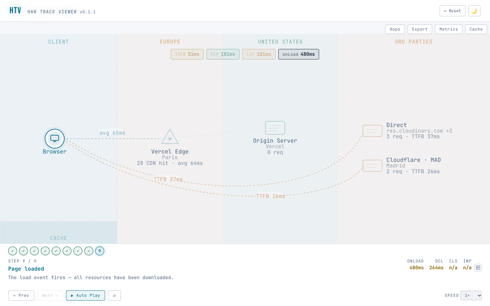

# har-trace-viewer

[](https://github.com/nucliweb/har-trace-viewer/actions/workflows/ci.yml)

Offline HAR + Chrome trace analyzer that shows how a page load travels through CDN, origin and third parties, with cache recommendations and first-vs-repeat comparison.



Try it in the browser at [har-trace-viewer-web.vercel.app](https://har-trace-viewer-web.vercel.app) with your own HAR and trace files or the built-in demo flow.

Analyzes HAR and Chrome trace files and shows the page load step by step, with its network requests, hosts, CDN and cache behavior and performance metrics: in the terminal, as a self-contained HTML report to share, or as JSON for other tools and AI agents.

## Usage

```bash
htv <file.har[.gz]> [<trace.json[.gz]>] [-o <dir|file.html|file.json>] [--format tui|html|json|findings|markdown|csv|mermaid] [options]
htv --page <name> --har <file.har[.gz]> [--trace <file.json[.gz]>] [--select <id|text>] [--page <name> ...] [-o <dir|file.html|file.json>] [--format tui|html|json|findings|markdown|csv|mermaid] [--bundle] [--region default|cn] [--compare | --compare-with <file.har[.gz]> [--compare-trace <file>] [--compare-select <id|text>]]
```

A HAR can be given on its own (`htv page.har`), followed by its Chrome trace (`htv page.har trace.json.gz`); files are told apart by extension, so a HAR saved with another extension needs `--har`.

### Output

The destination picks the format:

| Command                          | Output                                                                                                                        |
| -------------------------------- | ----------------------------------------------------------------------------------------------------------------------------- |
| `htv page.har`                   | Browses the report in the terminal: Findings, Overview, Steps, Hosts and Cache & network tabs (needs an interactive terminal) |
| `htv page.har -o r.html`         | A single self-contained HTML file with the interactive diagram, which opens offline                                           |
| `htv page.har -o r.json`         | The full analysis as JSON                                                                                                     |
| `htv page.har --format json`     | The same JSON on stdout, to pipe into another tool or an AI agent                                                             |
| `htv page.har --format findings` | Only the [findings](#findings) of each page and its metrics, as compact JSON on stdout (or `-o findings.json`)                |
| `htv page.har --format markdown` | A [Markdown report](#markdown-csv-and-mermaid) to paste into a ticket or a doc, on stdout (or `-o report.md`)                 |
| `htv page.har --format csv`      | One CSV row per request, on stdout (or `-o requests.csv`)                                                                     |
| `htv page.har --format mermaid`  | A Mermaid sequence diagram of the document request per page, on stdout (or `-o diagram.md`)                                   |
| `htv page.har -o report/`        | A directory with `index.html` and its assets (`--bundle` inlines them)                                                        |

In the terminal, `1`–`5` or `Tab` switch tabs, `←`/`→` walk the steps on the Steps tab and the pages of a multi-page flow elsewhere (`p`/`P` next and previous page too), `↑`/`↓` and `PgUp`/`PgDn` scroll, `a`/`b` pick the side whose findings or cache a comparison shows, and `q` quits.

The JSON holds the version of htv that wrote it and the flow the HTML report draws: `{ "htvVersion", "kind": "flow", "flow" }`, or `{ "htvVersion", "kind": "comparison", "a", "b" }` for a comparison. Each flow carries its data-model `version`, its pages with their parsed HAR entries and trace metrics, the topology and cache report of every page (`pageAnalyses`) and the steps of the diagram.

### Findings

htv turns its analyses into a list of findings per page, ordered by severity (critical, warning, info, good) and, within a severity, by the time and bytes at stake. Each finding has:

| Field            | Content                                                                                                                                                                   |
| ---------------- | ------------------------------------------------------------------------------------------------------------------------------------------------------------------------- |
| `id`             | A stable kebab-case rule id, such as `document-redirects`, `duplicate-requests`, `cdn-miss-document`, `versioned-assets-not-cached` or `slow-lcp`                         |
| `title`          | The finding in a few words, with its count: `2 requests failed (4xx)`, `LCP is poor: 4.6 s`                                                                               |
| `severity`       | `critical`, `warning`, `info` or `good`                                                                                                                                   |
| `metric`         | What it affects: `ttfb`, `fcp`, `lcp`, `cls`, `inp`, `transfer`, `requests` or `none`                                                                                     |
| `summary`        | What was found, in one sentence with its numbers                                                                                                                          |
| `recommendation` | What to do about it                                                                                                                                                       |
| `confidence`     | `high` when read from the recording itself (status codes, headers, measured metrics), `medium` when inferred (CDN headers, ratios), `low` when the recording may cause it |
| `evidence`       | The resources that show it: `url`, and `bytes`, `ms` and `detail` when known                                                                                              |
| `page`           | The page `index` and `name`, and the `side` (`a` or `b`) in a comparison                                                                                                  |
| `source`         | The analysis it comes from: `cache`, `network`, any other report of the page, or `metrics`                                                                                |

The findings come from the recommendations of every report of a page (cache, network, and the others the analysis adds) and from the metrics themselves: TTFB, FCP, LCP, CLS and INP rated against the web.dev thresholds are a `critical` finding when poor and a `warning` when they need improvement, and a single `good` finding says so when every measured one is good (it needs a trace for the LCP).

`--format findings` writes them as JSON, with the metrics summary of each page as numbers (times in ms, sizes in bytes, ratios from 0 to 1, `null` when the recording cannot provide the value). The document names the [JSON schema](packages/core/schema/findings.schema.json) (draft 2020-12) that describes it, which ships with the package as `dist/findings.schema.json`. A comparison lists the pages of side `a`, then those of side `b`.

```bash
$ htv page.har trace.json.gz --format findings
{
  "schema": "https://unpkg.com/har-trace-viewer@0.1.1/dist/findings.schema.json",
  "htvVersion": "0.1.1",
  "generatedAt": "2026-11-01T13:42:15.887Z",
  "pages": [
    {
      "name": "Page 1",
      "metrics": { "ttfb": 50.6, "serverWait": 48.7, "fcp": 181.5, "lcp": 181.5, "cls": null, "inp": null, "requests": 34, "transferBytes": 799947, ... },
      "findings": [
        {
          "id": "duplicate-requests",
          "title": "9 resources downloaded more than once",
          "severity": "info",
          "metric": "transfer",
          "summary": "The page fetched these URLs over the network more than once, downloading 153 KB again.",
          "recommendation": "A <link rel=preload> or prefetch whose as, crossorigin or credentials does not match the request that uses it is fetched twice, ...",
          "confidence": "low",
          "evidence": [{ "url": "https://example.com/_next/static/chunks/169-7c4f23f868dd8b78.js", "detail": "fetched 2×", "bytes": 55658 }, ...],
          "page": { "index": 0, "name": "Page 1" },
          "source": "network"
        },
        ...
      ]
    }
  ]
}
```

The same findings open the terminal report, on the Findings tab (`1`), grouped by severity with the metric, the summary, what to do and up to three evidence rows each; and in the HTML report and the web app, the Findings button opens them for the current page, with the number of critical and warning findings on the button. In a comparison, `a`/`b` pick the side on the Findings tab, and each diagram has its own Findings button.

### Markdown, CSV and Mermaid

`--format markdown` writes a report for a ticket or a doc, in GitHub-flavoured Markdown without HTML. Each page has a title with its name and URL, a Metrics table (value and web.dev rating), its [findings](#findings) grouped by severity (critical, warning, info; the good ones in one line) with the summary, the recommendation, up to five evidence rows and a note with the source and confidence, and a Hosts table (provider, PoP, requests, cache hits, bytes, median TTFB, protocol). A comparison opens with a table of the metrics of A and B, their delta and rating, before the sections of each side. `-o report.md` alone picks this format.

`--format csv` writes one row per request of every page, as RFC 4180 CSV with `\r\n` line endings and a header row: `page, side, url, host, type, method, status, protocol, encoding, from_cache, start_ms, blocked_ms, dns_ms, connect_ms, ssl_ms, send_ms, wait_ms, receive_ms, duration_ms, transfer_bytes, body_bytes, priority`. Times are ms with at most one decimal; a phase that did not apply (DNS on a reused connection) is empty, and `connect_ms` is the TCP handshake alone, with TLS in `ssl_ms`. `side` is `a` or `b` in a comparison and empty otherwise. `-o requests.csv` alone picks this format. The findings are not available as CSV; `--format findings` gives them as JSON, which any JSON tool converts to CSV.

`--format mermaid` writes, per page, a fenced `mermaid` block with a sequence diagram of the document request: Browser, the GFW when `--region cn` draws it, the CDN edge (provider and PoP) and the origin (region), with the TTFB and the CDN cache status on the response. GitHub, GitLab and most doc tools render it. An `--output` takes `.md`, `.mmd` or `.mermaid`.

### Options

| Flag                       | Description                                                                                                                                                                 |
| -------------------------- | --------------------------------------------------------------------------------------------------------------------------------------------------------------------------- |
| `<file>`                   | A HAR (`.har`, `.har.gz`) or a Chrome trace (`.json`, `.json.gz`) given without its flag, attached to the preceding `--page`                                                |
| `--page <name>`            | Page label (can be specified multiple times for multi-page reports)                                                                                                         |
| `--har <file>`             | HAR file (`.har` or `.har.gz`) for the preceding `--page`                                                                                                                   |
| `--trace <file>`           | Chrome trace file (`.json` or `.json.gz`) for the preceding `--page`                                                                                                        |
| `--select <value>`         | For the preceding `--har` with several pages (WebPageTest runs and views): keep only the matching pages, by page id, comma-separated ids or text/regex on id, title and URL |
| `--list-pages`             | Print the pages (id, entries, title) of each `--har` and exit without generating                                                                                            |
| `--compare`                | Compare the two pages of the flow instead of chaining them: the first is A (top), the second B (bottom); the flow must have exactly two pages                               |
| `--compare-with <file>`    | Compare the flow (A, one page) with another HAR (B)                                                                                                                         |
| `--compare-trace <file>`   | Chrome trace for the `--compare-with` HAR                                                                                                                                   |
| `--compare-select <value>` | Page of a multi-page `--compare-with` HAR, as `--select`                                                                                                                    |
| `-o, --output <path>`      | Where the report is written: a `.html` file (self-contained), a `.json` file, or a directory; without it, the report opens in the terminal                                  |
| `--format <format>`        | `tui`, `html`, `json`, `findings`, `markdown`, `csv` or `mermaid`; every format but `tui` and `html` prints to stdout without `--output`                                    |
| `--bundle`                 | For a directory `--output`: inline all assets (CSS, JS, fonts) into its `index.html`                                                                                        |
| `--region <id>`            | Client network region: `default`, or `cn` to draw the Great Firewall between the browser and the first server                                                               |
| `--budget <list>`          | `<metric>=<value>[,...]`: fail (exit 2) when a page goes over a limit; repeatable. See [CI budgets](#ci-budgets)                                                            |
| `--budget-strict`          | Fail a budget whose metric the page cannot provide (LCP without a trace) instead of passing it as `n/a`                                                                     |
| `--fail-on <severity>`     | `critical` or `warning`: fail (exit 2) when a [finding](#findings) of that severity or worse exists                                                                         |
| `-h, --help`               | Print the usage and exit                                                                                                                                                    |
| `-v, --version`            | Print the version and exit                                                                                                                                                  |

### CI budgets

`--budget` and `--fail-on` turn htv into a check for CI. Each budget is checked on every page, and on both sides of a comparison:

| Metric                                                      | Value                                                                                               |
| ----------------------------------------------------------- | --------------------------------------------------------------------------------------------------- |
| `ttfb`, `server-wait`, `fcp`, `lcp`, `dcl`, `onload`, `inp` | Maximum in ms: `2500`, `2500ms` or `2.5s`                                                           |
| `cls`                                                       | Maximum score: `0.1`                                                                                |
| `requests`                                                  | Maximum number of network requests: `80`                                                            |
| `transfer`                                                  | Maximum bytes on the wire: `500000`, `500kb`, `1.5mb` (1 kb = 1000 bytes, as the report shows them) |
| `cdn-hit-ratio`, `cache-hit-ratio`                          | Minimum ratio: `0.9` or `90%`                                                                       |

After the report is written, htv prints one line per budget per page (`pass` or `FAIL`, the actual value and the limit) and one line per [finding](#findings) that reaches `--fail-on`: a recommendation of the cache, network or another report, or a Core Web Vital or TTFB rated poor (`critical`) or in need of improvement (`warning`). The lines go to stderr, so `--format json` keeps stdout pure JSON; without `--output` no terminal report opens, and the result is printed to stdout instead, so the command runs without a TTY. A metric the page cannot provide (LCP without a trace, INP without interactions) shows `n/a` and passes, unless `--budget-strict` is given.

Exit codes: `0` every check passed, `2` a budget or `--fail-on` failed (the report is still written), `1` usage or input errors.

```bash
$ htv page.har trace.json.gz --budget lcp=2.5s,transfer=500kb,cdn-hit-ratio=95% --fail-on warning
Budgets:
  pass  Page 1  lcp            181 ms  <= 2500 ms
  FAIL  Page 1  transfer       800 KB  <= 500 KB
  pass  Page 1  cdn-hit-ratio  100.0%  >= 95.0%
Findings at warning or worse:
  pass  no warning or critical findings
Checks failed: 1 of 3 budgets failed.
$ echo $?
2
```

### Examples

Single page:

```bash
htv --page "Home" --har home.har --trace home.json.gz --output report/
```

Multi-page comparison:

```bash
htv \
  --page "Home"    --har home.har    --trace home.json.gz \
  --page "Checkout" --har checkout.har \
  --output report/
```

Client in China (adds the Great Firewall to the diagram; without the flag the CLI only prints a note when latencies suggest it):

```bash
htv --page "Home" --har home.har --output report/ --region cn
```

Comparison of a WebPageTest first view and repeat view (without and with cache), both from the same HAR:

```bash
htv --har wpt.har --select page_1_0_1,page_1_1_1 --compare --output compare.html
```

Comparison of two recordings, each with its trace:

```bash
htv --page "Without cache" --har cold.har --trace cold.json.gz \
    --compare-with warm.har --compare-trace warm.json.gz --output compare/
```

A comparison report stacks the two diagrams (A on top, B below) and drives them with one step track: each step shows the step of the same kind (connection, TTFB, critical resources, FCP, third parties, LCP, load) on both, and a side without that step keeps its previous one, dimmed. The step panel lists both sides' metrics with the B − A delta, and the Deltas panel compares the metrics summary (TTFB, paints, CLS, INP, DCL, onLoad, requests, transfer, cache hit ratios) and every host's requests and TTFB. In the web app, the builder's "Compare with…" drop target takes the second HAR (and trace), and a multi-page HAR offers "Compare pages", which proposes the first and the repeat view of a WebPageTest run.

Portable single-file report:

```bash
htv --page "Home" --har home.har --output report.html
```

CI check that still publishes the report: exits 2 when the LCP goes over 2.5 s, the CDN serves less than 90% of the own resources or a critical finding shows up:

```bash
htv page.har trace.json.gz -o report.html --budget lcp=2.5s,cdn-hit-ratio=90% --fail-on critical
```

A directory report (`--output report/`) without `--bundle` loads its scripts as ES modules from `assets/`, which browsers block over `file://`; serve the folder over HTTP (for example `npx serve report/`), add `--bundle`, or write a `.html` file, which opens by double-click.

## Why htv

- **Hop-by-hop diagram from the HAR alone.** The page load is drawn step by step across browser, CDN edge (with its PoP location), origin and third parties, using only the headers and timings already in the capture.
- **Cache analysis that includes the CDN.** Browser cache headers and CDN hit/miss are read together, flagging immutable candidates and hashed assets served with `no-store`.
- **First vs repeat comparison.** Two captures of the same page are compared with per-request and per-metric deltas.
- **One core, three outputs.** The terminal report, the self-contained HTML report and the JSON output come from the same analysis, so scripts and AI agents see what people see.
- **Offline and MIT.** Nothing is uploaded; HAR files, which often contain cookies and tokens, stay on your machine.

| Tool                         | What it does better                           | What htv adds                                               |
| ---------------------------- | --------------------------------------------- | ----------------------------------------------------------- |
| Google HAR Analyzer          | Request filters and HAR sanitizing            | CDN and origin hops, cache analysis, first-vs-repeat deltas |
| HAR Viewer (Jan Odvarko)     | Classic, familiar waterfall                   | Step-by-step diagram by network node, CDN and cache context |
| wiretrail                    | CI failure thresholds, fast Rust binary       | Interactive HTML report, CDN diagram, comparison            |
| waterfall-tools (Pat Meenan) | Many input formats                            | CDN/PoP hop diagram and cache recommendations               |
| WebPageTest                  | Live tests from many locations, CDN detection | Works offline on captures you already have                  |

## Packages

| Package            | Description                                                        |
| ------------------ | ------------------------------------------------------------------ |
| `@htv/core`        | HAR/trace parsing, node detection, cache analysis, flow generation |
| `har-trace-viewer` | `htv` command-line tool (`npx har-trace-viewer`)                   |
| `@htv/web`         | React viewer app embedded in generated reports                     |

## Development

Install dependencies:

```bash
npm install
```

Run tests:

```bash
npm test
```

Type-check all packages:

```bash
npm run typecheck
```

Build:

```bash
npm run build
```

### Demo flow

The web app's empty state offers a "Load demo flow" button. The flow it loads is pre-generated from the core test fixtures (`webperf-snippets.har.fixture.json` and `webperf-snippets.trace.fixture.json`) and stored in `packages/web/src/demo/demo-flow.json`. It is a separate chunk fetched on click, so it does not weigh on the main bundle, and it is not offered inside generated reports. Regenerate it after changing the flow format or the fixtures with `npm run demo:build -w @htv/web`.

## Releasing

The CLI is published to npm as `har-trace-viewer` by `.github/workflows/release.yml` when a `v*` tag is pushed. The tag must equal `v` plus the version in `packages/cli/package.json`, otherwise the workflow fails.

```bash
npm version <patch|minor|major> -w har-trace-viewer
git commit -am "Release v<version>"
git tag v<version>
git push --follow-tags
```

The workflow publishes with npm trusted publishing: npm accepts the OIDC token of the run instead of a stored secret, and adds the provenance of the package. The package settings on npmjs.com name `nucliweb/har-trace-viewer`, the workflow `release.yml` and the environment `npm-publish` as its trusted publisher, and the `npm-publish` environment asks a maintainer to approve each run before it publishes.
